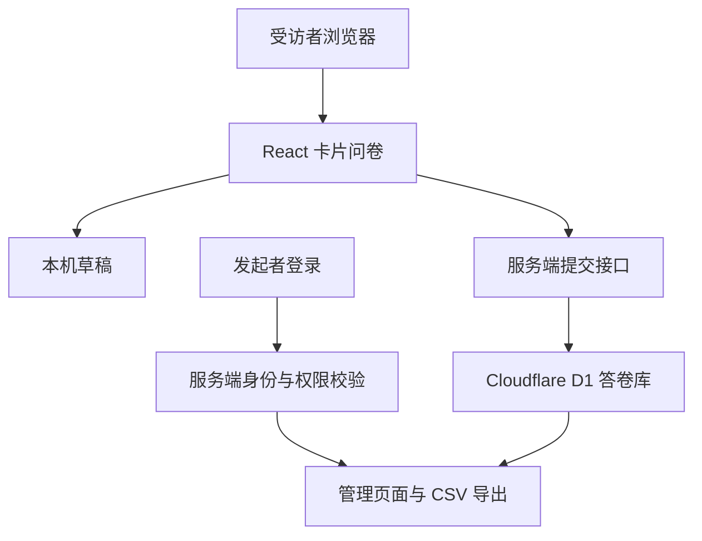

# 回音计划 · 联合学院学生诉求调研

面向武汉大学杜伦大学联合学院在读本科生的学生提案配套问卷，用于了解反馈渠道认知、实际沟通经历，以及对回应与信息公开机制的期待。

**提案主题：关于完善新设中外合作办学学院学生诉求收集、回应与信息公开机制的提案。**

- GitHub 公共源码：https://github.com/xionghezi/project-echo-for-WDJ
- 当前正式问卷：https://whu-durham-voice-2026.nuttyperch4097.chatgpt.site/
- 当前问卷版本：`2026-10-27.release1`
- 文档日期：2026 年 10 月 27 日
- 项目性质：学生发起的匿名调研，非学校或学院官方诉求受理平台。

## 1. 设计目标

以简单、明确的交互降低填写成本，让同学能够按真实经历表达意见。问卷以选择题为主，不设正确答案、不预选选项，也不根据回答表达赞同或否定。

调研关注既有渠道的知晓、衔接、回应和信息公开，包括“珞珈直通车”；不把另建投诉平台或现有机制无效作为预设结论。本网页收集研究意见，不代为提交具体诉求，也不承诺学校办理时限。

## 2. 底层架构

系统采用浏览器交互、服务端接口和持久化数据库分层设计。浏览器负责呈现与草稿；服务端负责校验、保存和权限；数据库保存正式提交的答卷。问卷公开访问，管理功能独立验证身份。



| 层次 | 当前实现 | 作用 |
| --- | --- | --- |
| 页面与交互 | React、TypeScript、CSS、SVG | 首页、答题卡、进度条、核对页、动效和反馈 |
| 应用框架与构建 | Vinext、Vite，使用 Next.js App Router 风格的目录与接口 | 组织页面、服务端渲染和 API 路由 |
| 托管与运行 | 自有 Cloudflare Workers | 独立部署服务端和静态资源；此副本尚未上线 |
| 数据访问 | Drizzle ORM | 用结构化查询读写数据库 |
| 持久化 | Cloudflare D1 | 保存正式提交的问卷数据 |
| 管理身份 | Cloudflare Access JWT 验签、服务端管理员校验、读取开关 | 限制原始答卷读取与导出 |

### 2.1 用统一题目定义驱动界面

`lib/survey.ts` 集中定义题目编号、文字、选项、多选上限、互斥项与校验规则。页面展示、提交前检查和服务端保存使用同一套定义，减少前后端规则不一致的情况。

正式版固定 **13 题：12 道选择题和 1 道选填补充题**。所有受访者按相同顺序填写，没有自动跳题或条件分支；缺少对应经历时可主动选择“不适用”。选好答案后，受访者自行点击下一题、使用键盘或向右滑动继续。

进度由当前题号和固定题目总数计算。答题流程按“首页 → 答题 → 核对 → 完成”组织，核对页支持返回修改；仅服务端确认保存成功后，正式答卷才显示保存完成。

### 2.2 将浏览与翻题手势分开

卡片内容和选项不设置内部滚动区域，长题采用整页上下浏览。`lib/gestures.ts` 根据移动方向锁定手势：明确的横向动作且右移达到阈值才允许继续，纵向动作保持浏览，减少滚动时误翻题。

流程图使用 CSS 实现模块文字淡入与箭头移动，帮助解释“提交、确认或转交、跟进、结果说明”。吉祥物位于卡片外侧，随选择、输入和继续动作改变姿势。系统开启“减少动态效果”时停用相关动画，保留文字信息。

### 2.3 隔离草稿、试填与正式提交

- **正式草稿：**保存在当前浏览器的 `localStorage`，支持刷新续填和返回修改；清除网站数据或换设备后不保证恢复。
- **试填：**答案保留在页面内存，完成试填不调用正式保存接口，也不会自动带入正式答案。
- **正式提交：**用户核对后，页面向 `POST /api/responses` 发送答卷；服务器再次检查版本、参与确认、必答题、合法选项、多选上限、互斥项和补充字数，并检查请求来源、格式及大小。

服务端通过随机答卷编号实现重试去重：相同编号与相同答案再次提交，不增加记录；相同编号对应不同答案时拒绝覆盖。这主要防止网络重试产生重复记录，不能据此核验身份或阻止跨设备重复填写。

### 2.4 将公开答题与私密管理分开

受访者无需登录。首页“发起者入口”通向 /admin，由 Cloudflare Access 保护。服务端验证签名、团队签发者、应用 AUD、令牌有效期和管理员邮箱；不信任客户端提供的旧 Sites 身份头。独立的读取开关默认关闭，真实身份保护验收通过前不能读取答卷。/api/export 在服务端单独复核，不能靠隐藏前端按钮保护。

管理页面默认只统计当前正式版本。发布前版本的记录单独查看和导出，不混入正式统计。CSV 使用 UTF-8 BOM，处理引号、换行及可能触发表格公式的内容；导出响应设置为私密且不缓存。

## 3. 数据与接口

数据库表 `survey_responses` 保存以下字段：

| 字段 | 内容 | 用途 |
| --- | --- | --- |
| `id` | 随机答卷编号 | 保存确认与重试去重，不是学号或账号 ID |
| `created_at` | 提交时间，UTC | 记录提交时间 |
| `version` | 问卷版本 | 区分正式版与历史记录 |
| `route` | 反馈经历类型 | 汇总“已反馈／有诉求未反馈／暂无诉求”；字段名沿用历史命名，不代表当前存在分支跳题 |
| `answers` | JSON 格式的选择及选填文本 | 调研分析 |
| `duration_seconds` | 客户端上报的答题用时 | 辅助检查，不作为身份或真实性证明 |

参与确认用于提交校验，当前数据表不单独保存姓名或身份核验信息。

| 路径 | 功能 | 访问边界 |
| --- | --- | --- |
| `/` | 问卷首页与填写 | 公开 |
| `POST /api/responses` | 校验并保存正式答卷 | 无需登录，必须通过提交规则 |
| `/admin` | 发起者管理界面 | 登录并通过所有者校验 |
| `GET /api/export` | 统计与 CSV 导出 | 仅通过所有者校验后可访问 |
| `GET /api/health` | 检查数据库连接与当前版本 | 公开，但不返回答卷、人数或身份信息 |
| `GET /api/session` | 返回是否具有管理权限的布尔值 | 不返回身份资料或答卷 |

## 4. 匿名调查声明

> 本问卷为学生发起的匿名调查，面向武汉大学杜伦大学联合学院在读本科生，参与完全自愿。回答仅用于本次学生提案的调研分析与撰写，研究成果以汇总形式呈现。
>
> 受访者无需登录。问卷不设置姓名、学号、邮箱或联系方式填写项，应用不会将 IP 地址或平台账号身份写入答卷数据库。系统保存题目答案、可选补充文本、提交时间、答题用时、问卷版本及随机答卷编号。
>
> 补充题可以留空。请勿在补充内容中填写本人或他人的姓名、学号、联系方式，以及能够识别具体个人的事件细节。提交前可以返回修改或随时退出；正式提交后，当前页面不提供自助修改或撤回功能。
>
> 应用内的原始答卷查看与导出权限限发起者账号。分析与展示时应使用去除可识别细节后的汇总，不公开个人投诉原文。
>
> 上述匿名范围指问卷应用与答卷记录。网站托管、网络或登录服务可能为运行与安全保留访问日志，因此不承诺平台或网络层面完全不可追溯。匿名调查也不能保证选填文本不会因内容过于具体而间接识别个人。

### 本机数据与保存期限

未提交的正式草稿仅由页面保存在当前浏览器，不写入答卷库；共用设备的使用者应在退出后清除相关网站数据。成功提交后，本机草稿被替换为提交凭据记录。

当前实现未设置答卷自动到期删除机制，也没有按匿名编号自助删除答卷的接口，不应宣称“退出即删除已提交答卷”或“研究结束自动删除”。如后续确定保留期限，应同步修改实现与公开说明。

## 5. 代码组织与维护思路

| 位置 | 职责 |
| --- | --- |
| `app/page.tsx` | 首页、答题状态、草稿、核对与提交交互 |
| `app/components/Companion.tsx` | 吉祥物状态与呈现 |
| `app/globals.css` | 响应式布局、流程图及吉祥物动效 |
| `lib/survey.ts` | 题目、版本、答案整理与共享校验 |
| `lib/gestures.ts` | 手势方向锁定与继续条件 |
| `app/api/responses/route.ts` | 正式答卷保存与重试处理 |
| `app/admin/` | 受保护的管理页面 |
| `lib/admin.ts` | 服务端所有者权限判断 |
| `app/api/export/route.ts`、`lib/export.ts`、`lib/csv.ts` | 版本过滤、统计和 CSV 导出 |
| `db/schema.ts`、`db/index.ts` | 数据结构与 D1 连接 |
| `tests/` | 问卷规则、手势、权限与 CSV 校验 |

修改题目或统计口径时，应同步更新版本和本机草稿键，保留并区分旧版记录。配置身份校验所需的私密环境变量时，不应把实际值写进 README、源代码或客户端包。

本迁移副本已完成类型检查、自动测试、生产构建和本地 Workers/D1 验证；浏览器已验证草稿恢复与完整试填隔离。此次没有上线；真实 Access 管理员/非管理员登录和线上导出验收须在读取开关关闭时按第 7 节完成。

## 6. 调研结果的解释边界

参与资格依靠自报，未进行学生身份认证、强防刷或跨设备去重。提交份数不等于经核验的有效样本数。

分析前应检查重复、明显矛盾与无效回答。经历题中的“不适用”需按题目含义处理，并使用对应有效回答数作为分母。公开邀请形成的便利样本不能直接代表学院全体学生；问卷结果应与访谈、既有渠道说明等证据共同支持提案。


## 7. 独立 Cloudflare Workers 部署（Windows PowerShell）

此改动基于 GitHub 提交 `9ad9d37`，迁移代码已在本地验证，并提交到原仓库的迁移分支供审阅；**没有部署网站、修改原 Sites 正式站点，也没有迁移实际答卷**。新 D1 初始为空。原域名的草稿属于原域名的 localStorage，浏览器不会自动将它带到新域名。

保留锁定版本 Vinext 1.0.0-beta.5、Vite 8.0.13、Cloudflare Vite 插件 1.37.1、Wrangler 4.92.0；核对了该版本随 npm 包发布的 README 和初始化代码。采用该版本官方的 Cloudflare Vite 插件 RSC/SSR 构建输出，再用 Wrangler 部署 `dist/server/wrangler.json`。不运行最新初始化器，不升级到当前文档中的 Vite 插件 v2/cf 配置，不使用 Sites 构建或控制平面。

### 7.1 安装、检查、本地预览

需要 Node.js >=22.13.0（此次测试为 24.18.0），pnpm 固定为 11.25.0。以下命令从本仓库根目录运行；使用 .cmd 避免 PowerShell 脚本执行策略阻止 npm.ps1/pnpm.ps1。每步退出码应为 0，失败先停止后续步骤。

```powershell
# 若尚未安装这个版本的 pnpm，先执行：
npm.cmd install --global pnpm@11.25.0

pnpm.cmd install --frozen-lockfile
pnpm.cmd typecheck
pnpm.cmd test
pnpm.cmd build
pnpm.cmd test:integration

# 只操作本机 D1；随后打开终端打印的本地地址
pnpm.cmd db:migrate:local
pnpm.cmd start
# 另一个可选开发入口：pnpm.cmd dev
```

本地构建不需要真实数据库 ID，也不会伪造占位 ID。无 ID 的 wrangler.jsonc 仅用于本地 D1 和构建；部署脚本强制要求另行配置真实 ID。本地状态默认位于系统临时目录的 project-echo-local，避免 Windows 深目录触发 SQLite 路径长度错误。需要保留本地测试状态时，先在各终端设置同一个短路径 `$env:ECHO_LOCAL_STATE = 'C:\echo-local'`。系统可能清理临时目录，本地状态不是生产存储。重新 build 前先停止正在使用 dist 的预览，避免构建替换模块时触发 Wrangler 重载错误。

若受限 Windows 环境禁止 Wrangler 写入用户配置目录，可仅在当前 PowerShell 会话设置：

```powershell
$env:WRANGLER_LOG_PATH = Join-Path (Get-Location) '.wrangler/logs'
$env:XDG_CONFIG_HOME = Join-Path (Get-Location) '.wrangler/xdg'
$env:WRANGLER_SEND_METRICS = 'false'
```

集成测试建立唯一临时 D1、运行本地生产构建、使用合成答卷，结束后停止服务并清理自己的临时数据库；不会选择 remote D1。需先 build。测试自动选择空闲的本机端口。线上 Access 登录不由本地测试代替。

### 7.2 在自己的账号准备 D1、域名和 Access

以下为**未来部署步骤，本次没有执行**。

先准备一个你拥有、已由 Cloudflare 管理的自定义域名。使用新 Worker 名称和新域名，不覆盖原 Sites 正式站点。模板禁用 workers.dev 和 preview_urls，减少绕过 Access 的备用入口；即使有人直接抵达 Worker，服务端仍需验签和管理员校验。

```powershell
pnpm.cmd exec wrangler login
pnpm.cmd exec wrangler whoami
pnpm.cmd exec wrangler d1 list
# 仅当还没有自己的 D1 时创建一个（有现成数据库则跳过）：
pnpm.cmd exec wrangler d1 create project-echo
```

在 Cloudflare Zero Trust 中创建一个 Self-hosted Access application，将新域名下的 /admin、/admin/*、/admin.rsc、/api/export、/api/export/*、/api/session、/api/session/* 加入**同一个应用**，使它们使用同一个 AUD。不要保护整个问卷域名，首页和 POST /api/responses 应保持公开。Allow policy 仅允许管理员本人，不能配置 Everyone、Bypass 或让服务令牌代替管理员。配置身份提供商和所需的 MFA；邮箱单次验证码可作为可用的登录方式，但本项目不保存邮箱密码。

Cloudflare 路径规则需结合后台实际匹配方式检查，尤其根路径、尾斜线、子路径和 RSC 请求。不要用更具体的其他 Access application 的 Bypass 策略覆盖这些路径。服务端无条件对 /admin* 和 /api/export* 再次校验。

复制 Access 应用的 AUD tag 和团队域名（形如 https://团队名.cloudflareaccess.com，不带末尾斜线）。用下列交互命令生成被 gitignore 排除的本地配置；所有输入都是资源标识，不需要输入密码、Token 或答卷：

```powershell
$echoConfig = Get-Content -Raw .\deploy-config.example.json | ConvertFrom-Json
$echoConfig.workerName = Read-Host '新 Worker 名称，例如 project-echo'
$echoConfig.accountId = Read-Host '你自己的 Cloudflare Account ID'
$echoConfig.databaseName = Read-Host '你自己的 D1 数据库名称'
$echoConfig.databaseId = Read-Host '该 D1 的真实 database_id'
$echoConfig.hostname = Read-Host '新自定义域名，不含 https://'
$echoConfig.accessTeamDomain = Read-Host 'Access 团队域名，含 https://'
$echoConfig.accessAudience = Read-Host '同一个 Access application 的 64 位 AUD tag'
$echoConfig.adminAccessEnabled = $false
[IO.File]::WriteAllText(
  (Join-Path (Get-Location) 'deploy-config.local.json'),
  ($echoConfig | ConvertTo-Json -Depth 10),
  [Text.UTF8Encoding]::new($false)
)
pnpm.cmd configure:cloudflare
pnpm.cmd deploy:dry-run
```

configure 会生成 wrangler.local.json：绑定名始终为 DB；数据库 ID 来自你的输入，缺失、格式错误或原全零占位值都拒绝。两个本地配置文件均不提交。部署脚本会重新构建并检查构建产物的账号、Worker、D1、读取开关和备用入口设置；dry-run 不上传代码。

### 7.3 首次部署保持所有答卷读取关闭

完成上面的 Access 配置和 dry-run 后，以下命令才会修改你自己的 Cloudflare 账号；本次没有执行：

```powershell
# 明确 --remote 才会修改你自己的 D1；应用现有 schema，不导入答卷
pnpm.cmd exec wrangler d1 migrations apply DB --remote --config wrangler.local.json
# 第一次发布的 ADMIN_ACCESS_ENABLED 必须仍为 false
pnpm.cmd deploy
# 在交互提示中输入管理员邮箱（身份允许名单），不是邮箱密码
# 不把实际值写到源码、shell 参数、聊天或本地配置文件
pnpm.cmd exec wrangler secret put ADMIN_EMAIL --config wrangler.local.json
```

ADMIN_EMAIL 是身份允许名单，不是邮箱登录凭据；仍通过 Worker secret 保存，客户端包和 Git 不含实际值。不需要自建 JWT 密钥：Access 保管私钥，Worker 从配置的团队 JWKS 获取公钥并缓存。不得将 API Token、OAuth 凭据或邮箱密码粘贴进仓库；本地开发若需环境变量，用被排除的 .dev.vars，自行保管，不能把它作为生产认证替代品。

保持开关关闭，在真实域名做以下检查：

- 无痕浏览首页可公开填写；/api/health 只返回连接状态和版本。
- 匿名访问管理、JSON 统计、正式 CSV、历史 CSV：被 Access 拦截或由 Worker 返回 403，不能出现答卷或人数。
- 带任意 oai-authenticated-user-*、cf-access-authenticated-user-email 或伪造 cf-access-jwt-assertion 仍不能读取。
- 管理员经 Access 登录后访问 /api/session：应为 authenticatedAdmin=true、canManage=false；这验证真实签名、团队、AUD 和管理员邮箱匹配，但不释放答卷。
- 非管理员登录被 Access 拒绝；即使错误允许到 Worker，/api/session 也不能出现 authenticatedAdmin=true。
- 核对 workers.dev 和预览域名确实禁用；检查 Access 所有受保护路径、MFA/登录策略。新增其他域名时先纳入 Access，再开放路由。

只有这组真实身份保护检查通过后，才允许在本地配置中启用管理员读取并重新发布：

```powershell
$echoConfig = Get-Content -Raw .\deploy-config.local.json | ConvertFrom-Json
$echoConfig.adminAccessEnabled = $true
[IO.File]::WriteAllText(
  (Join-Path (Get-Location) 'deploy-config.local.json'),
  ($echoConfig | ConvertTo-Json -Depth 10),
  [Text.UTF8Encoding]::new($false)
)
pnpm.cmd configure:cloudflare
pnpm.cmd deploy:dry-run
pnpm.cmd deploy
```

启用后由管理员检查 /admin、正式统计与 CSV、历史统计与 CSV；同时用另一无痕会话确认匿名和非管理员仍被拒绝。导出是私密、不可缓存响应。出错时立即将 adminAccessEnabled 改回 false，configure 并 deploy，保持读取关闭后修复。不存在开发模式放行、固定密码或信任普通身份头的后门。

### 7.4 前后端职责与检查边界

前端保持原样：app/page.tsx、组件、CSS、13 题定义、草稿键、试填状态机、版本、核对页均未改。浏览器负责展示和本地草稿，不能授予管理权限。POST /api/responses 在服务端重新校验并写 D1；试填不调用保存。拒绝来源/格式/长度时，额外清理有上限的请求体，避免本地 Workers 连续请求出现 503。

Worker 在框架处理之前删除所有 oai-authenticated-user-* 头，对管理路径做默认拒绝保护；管理页面和导出接口分别再检查一次。只接受 cf-access-jwt-assertion 中经 RS256/JWKS 验证、issuer/audience/exp/iat/nbf 合法且 sub/email/type 齐全的应用令牌，再比对 ADMIN_EMAIL，最后要求 ADMIN_ACCESS_ENABLED=true。失败、配置缺失和密钥服务不可用均拒绝。/api/session 仅返回两个布尔值供验收，需同样置于 Access 保护下。

此次本地验证记录、逐文件解释和未完成的线上检查见 [MIGRATION.md](MIGRATION.md) 与 [RELEASE_CHECKS.md](RELEASE_CHECKS.md)。不将旧站点的生产验证结论当成本次迁移的线上验证。没有复制生产答卷；需要迁移历史数据时，应另行安排受控导入，绝不提交到公共仓库。

官方依据：[Vinext 官方仓库](https://github.com/cloudflare/vinext)、[Cloudflare Vite 插件](https://developers.cloudflare.com/workers/vite-plugin/)、[Access JWT 服务端验证](https://developers.cloudflare.com/cloudflare-one/access-controls/applications/http-apps/authorization-cookie/validating-json/)、[Access 路径规则](https://developers.cloudflare.com/cloudflare-one/access-controls/policies/app-paths/)；版本兼容性以本仓库锁定 npm 包内文档和实际构建为准。
