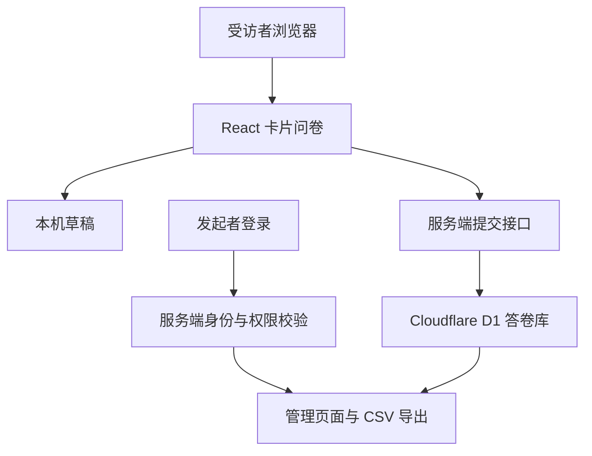

# 回音计划 · 联合学院学生诉求调研

面向武汉大学杜伦大学联合学院在读本科生的学生提案配套问卷，用于了解反馈渠道认知、实际沟通经历，以及对回应与信息公开机制的期待。

**提案主题：关于完善新设中外合作办学学院学生诉求收集、回应与信息公开机制的提案。**

- GitHub 公共源码：https://github.com/xionghezi/project-echo-for-WDJ
- 当前正式问卷：https://whu-durham-voice-2026.nuttyperch4097.chatgpt.site/
- 当前问卷版本：`2026-10-27.release1`
- 文档日期：2026 年 10 月 27 日
- 项目性质：学生发起的匿名调研，非学校或学院官方诉求受理平台。

## 1. 设计目标

以简单、明确的交互降低填写成本，让同学能够按真实经历表达意见。问卷以选择题为主，不设正确答案、不预选选项，也不根据回答表达赞同或否定。

调研关注既有渠道的知晓、衔接、回应和信息公开，包括“珞珈直通车”；不把另建投诉平台或现有机制无效作为预设结论。本网页收集研究意见，不代为提交具体诉求，也不承诺学校办理时限。

## 2. 底层架构

系统采用浏览器交互、服务端接口和持久化数据库分层设计。浏览器负责呈现与草稿；服务端负责校验、保存和权限；数据库保存正式提交的答卷。问卷公开访问，管理功能独立验证身份。

| 层次 | 当前实现 | 作用 |
| --- | --- | --- |
| 页面与交互 | React、TypeScript、CSS、SVG | 首页、答题卡、进度条、核对页、动效和反馈 |
| 应用框架与构建 | Vinext、Vite，使用 Next.js App Router 风格的目录与接口 | 组织页面、服务端渲染和 API 路由 |
| 托管与运行 | Sites、Cloudflare Workers | 发布网站并运行服务端逻辑 |
| 数据访问 | Drizzle ORM | 用结构化查询读写数据库 |
| 持久化 | Cloudflare D1 | 保存正式提交的问卷数据 |
| 管理身份 | Sites 提供的 ChatGPT 登录身份、服务端所有者校验 | 限制原始答卷读取与导出 |

### 2.1 用统一题目定义驱动界面

`lib/survey.ts` 集中定义题目编号、文字、选项、多选上限、互斥项与校验规则。页面展示、提交前检查和服务端保存使用同一套定义，减少前后端规则不一致的情况。

正式版固定 **13 题：12 道选择题和 1 道选填补充题**。所有受访者按相同顺序填写，没有自动跳题或条件分支；缺少对应经历时可主动选择“不适用”。选好答案后，受访者自行点击下一题、使用键盘或向右滑动继续。

进度由当前题号和固定题目总数计算。答题流程按“首页 → 答题 → 核对 → 完成”组织，核对页支持返回修改；仅服务端确认保存成功后，正式答卷才显示保存完成。

### 2.2 将浏览与翻题手势分开

卡片内容和选项不设置内部滚动区域，长题采用整页上下浏览。`lib/gestures.ts` 根据移动方向锁定手势：明确的横向动作且右移达到阈值才允许继续，纵向动作保持浏览，减少滚动时误翻题。

流程图使用 CSS 实现模块文字淡入与箭头移动，帮助解释“提交、确认或转交、跟进、结果说明”。吉祥物位于卡片外侧，随选择、输入和继续动作改变姿势。系统开启“减少动态效果”时停用相关动画，保留文字信息。

### 2.3 隔离草稿、试填与正式提交

- **正式草稿：**保存在当前浏览器的 `localStorage`，支持刷新续填和返回修改；清除网站数据或换设备后不保证恢复。
- **试填：**答案保留在页面内存，完成试填不调用正式保存接口，也不会自动带入正式答案。
- **正式提交：**用户核对后，页面向 `POST /api/responses` 发送答卷；服务器再次检查版本、参与确认、必答题、合法选项、多选上限、互斥项和补充字数，并检查请求来源、格式及大小。

服务端通过随机答卷编号实现重试去重：相同编号与相同答案再次提交，不增加记录；相同编号对应不同答案时拒绝覆盖。这主要防止网络重试产生重复记录，不能据此核验身份或阻止跨设备重复填写。

### 2.4 将公开答题与私密管理分开

受访者无需登录。首页“发起者入口”通向 `/admin`，查看后台需登录并通过所有者校验。登录成功本身不代表拥有答卷权限。

服务端检查托管平台注入的身份 ID 和邮箱，并将邮箱与私密环境变量 `ADMIN_EMAIL` 比对；缺少身份或不匹配时拒绝。所有者邮箱不写入客户端代码。`/api/export` 独立执行权限校验，不能依赖前端隐藏按钮作为保护。

管理页面默认只统计当前正式版本。发布前版本的记录单独查看和导出，不混入正式统计。CSV 使用 UTF-8 BOM，处理引号、换行及可能触发表格公式的内容；导出响应设置为私密且不缓存。

## 3. 数据与接口

数据库表 `survey_responses` 保存以下字段：

| 字段 | 内容 | 用途 |
| --- | --- | --- |
| `id` | 随机答卷编号 | 保存确认与重试去重，不是学号或账号 ID |
| `created_at` | 提交时间，UTC | 记录提交时间 |
| `version` | 问卷版本 | 区分正式版与历史记录 |
| `route` | 反馈经历类型 | 汇总“已反馈／有诉求未反馈／暂无诉求”；字段名沿用历史命名，不代表当前存在分支跳题 |
| `answers` | JSON 格式的选择及选填文本 | 调研分析 |
| `duration_seconds` | 客户端上报的答题用时 | 辅助检查，不作为身份或真实性证明 |

参与确认用于提交校验，当前数据表不单独保存姓名或身份核验信息。

| 路径 | 功能 | 访问边界 |
| --- | --- | --- |
| `/` | 问卷首页与填写 | 公开 |
| `POST /api/responses` | 校验并保存正式答卷 | 无需登录，必须通过提交规则 |
| `/admin` | 发起者管理界面 | 登录并通过所有者校验 |
| `GET /api/export` | 统计与 CSV 导出 | 仅通过所有者校验后可访问 |
| `GET /api/health` | 检查数据库连接与当前版本 | 公开，但不返回答卷、人数或身份信息 |
| `GET /api/session` | 返回是否具有管理权限的布尔值 | 不返回身份资料或答卷 |

## 4. 匿名调查声明

> 本问卷为学生发起的匿名调查，面向武汉大学杜伦大学联合学院在读本科生，参与完全自愿。回答仅用于本次学生提案的调研分析与撰写，研究成果以汇总形式呈现。
>
> 受访者无需登录。问卷不设置姓名、学号、邮箱或联系方式填写项，应用不会将 IP 地址或平台账号身份写入答卷数据库。系统保存题目答案、可选补充文本、提交时间、答题用时、问卷版本及随机答卷编号。
>
> 补充题可以留空。请勿在补充内容中填写本人或他人的姓名、学号、联系方式，以及能够识别具体个人的事件细节。提交前可以返回修改或随时退出；正式提交后，当前页面不提供自助修改或撤回功能。
>
> 应用内的原始答卷查看与导出权限限发起者账号。分析与展示时应使用去除可识别细节后的汇总，不公开个人投诉原文。
>
> 上述匿名范围指问卷应用与答卷记录。网站托管、网络或登录服务可能为运行与安全保留访问日志，因此不承诺平台或网络层面完全不可追溯。匿名调查也不能保证选填文本不会因内容过于具体而间接识别个人。

### 本机数据与保存期限

未提交的正式草稿仅由页面保存在当前浏览器，不写入答卷库；共用设备的使用者应在退出后清除相关网站数据。成功提交后，本机草稿被替换为提交凭据记录。

当前实现未设置答卷自动到期删除机制，也没有按匿名编号自助删除答卷的接口，不应宣称“退出即删除已提交答卷”或“研究结束自动删除”。如后续确定保留期限，应同步修改实现与公开说明。

## 5. 代码组织与维护思路

| 位置 | 职责 |
| --- | --- |
| `app/page.tsx` | 首页、答题状态、草稿、核对与提交交互 |
| `app/components/Companion.tsx` | 吉祥物状态与呈现 |
| `app/globals.css` | 响应式布局、流程图及吉祥物动效 |
| `lib/survey.ts` | 题目、版本、答案整理与共享校验 |
| `lib/gestures.ts` | 手势方向锁定与继续条件 |
| `app/api/responses/route.ts` | 正式答卷保存与重试处理 |
| `app/admin/` | 受保护的管理页面 |
| `lib/admin.ts` | 服务端所有者权限判断 |
| `app/api/export/route.ts`、`lib/export.ts`、`lib/csv.ts` | 版本过滤、统计和 CSV 导出 |
| `db/schema.ts`、`db/index.ts` | 数据结构与 D1 连接 |
| `tests/` | 问卷规则、手势、权限与 CSV 校验 |

修改题目或统计口径时，应同步更新版本和本机草稿键，保留并区分旧版记录。配置身份校验所需的私密环境变量时，不应把实际值写进 README、源代码或客户端包。

本次正式发布已通过类型检查、生产构建及 8 项自动测试，并验证本地完整提交、重复重试、异常请求拒绝、草稿恢复、试填隔离和窄屏布局。线上已确认公开访问、数据库连接与匿名导出拒绝。大陆直连、微信内置浏览器、真实手机触摸，以及发起者登录后的线上导出成功流程尚未实测。

## 6. 调研结果的解释边界

参与资格依靠自报，未进行学生身份认证、强防刷或跨设备去重。提交份数不等于经核验的有效样本数。

分析前应检查重复、明显矛盾与无效回答。经历题中的“不适用”需按题目含义处理，并使用对应有效回答数作为分母。公开邀请形成的便利样本不能直接代表学院全体学生；问卷结果应与访谈、既有渠道说明等证据共同支持提案。

## 7. GitHub 源码与运行部署

GitHub 公共仓库用于公开网页源代码和说明文档。公开副本不包含生产答卷、本机数据库、私密环境变量、登录凭据或原仓库的 Git 历史；托管配置保留数据库绑定名称，不绑定原网站的项目编号。

本项目包含服务端接口、D1 数据库及托管平台身份校验。仅将源码提交到 GitHub，不会创建新的可填写网址，也不会改变当前正式问卷地址。GitHub Pages 不能直接运行本项目的服务端和数据库；若迁移到其他运行环境，需重新配置数据库与可信身份校验，不能直接信任普通客户端提交的身份头。

本项目公开源码仓库为：https://github.com/xionghezi/project-echo-for-WDJ 。正式问卷继续由 Sites / Cloudflare Workers 承载，访问地址见文档开头；本次源码公开不构成网站迁移，也未启用 GitHub Pages 问卷部署。只有完成新的运行部署、验证提交保存与管理权限后，才应更新正式问卷访问地址。
